# Data model

The Cloud Firestore collections of the app, their fields and how they
reference each other. It is read from the code: the models in `lib/models/`,
the services in `lib/services/` and the checks in `firestore.rules`. Update this
file when a story adds or changes a collection or a field.

To see the diagram in VS Code, install the extension **Markdown Preview Mermaid
Support** (`bierner.markdown-mermaid`) and open the Markdown preview
(`Cmd+Shift+V` / `Ctrl+Shift+V`). GitHub shows it without an extension.

## Diagram

`PK` is the document ID, `FK` a field that holds the ID of another document.
`AUTH_USER` is the Firebase Authentication account, not a Firestore collection:
every `userId`, `senderId`, `signerId` and `advertiserId` holds its `uid`.

```mermaid
erDiagram
    AUTH_USER {
        string uid PK "Firebase Authentication, not Firestore"
        string email
        bool emailVerified "must be true to read or write any data"
    }

    apartments {
        string id PK "auto ID"
        string title
        string address
        string city
        string listingType "rent | sale"
        int price "CHF, per month for a rent"
        number rooms "int or double, e.g. 3.5"
        int surface "m2"
        string imageUrl
        string description
        string availability "available | reserved | unavailable"
        array amenities "balcony, garden, parking, elevator, furnished, cellar"
    }

    favourites {
        string id PK "userId_apartmentId"
        string userId FK
        string apartmentId FK
        timestamp createdAt "server time"
    }

    applications {
        string id PK "auto ID"
        string userId FK
        string apartmentId FK
        string apartmentTitle "copy of the title, max 200"
        string fullName "max 100"
        string phone "6-20 chars: digits, +, space, (, ), -"
        timestamp moveInDate "date only, local midnight"
        int occupants "1-10"
        string message "max 1000, may be empty"
        string status "submitted | underReview | accepted | rejected | withdrawn"
        timestamp submittedAt "server time"
        timestamp updatedAt "server time"
    }

    maintenanceRequests {
        string id PK "auto ID"
        string userId FK "property manager"
        string apartmentId FK
        string apartmentTitle "copy of the title, max 200"
        string category "plumbing | electrical | heating | appliances | other"
        string description "5-500"
        timestamp slotStart "start of a 30-minute slot"
        array reminders "1-3 of oneDay, oneHour, fiveMinutes"
        string status "scheduled | cancelled"
        timestamp createdAt "server time"
        timestamp updatedAt "server time"
    }

    advertiserContacts {
        string id PK, FK "= apartmentId"
        string advertiserId FK
        string advertiserName
    }

    advertiserMessages {
        string id PK "auto ID"
        string apartmentId FK
        string advertiserId FK "must match advertiserContacts"
        string senderId FK
        string senderEmail "from the login token"
        string subject "max 120"
        string body "max 2000"
        timestamp createdAt "server time"
        string status "always sent"
    }

    notifications {
        string id PK "auto ID"
        string userId FK
        string type "newListing | applicationStatus | announcement"
        string title "max 120"
        string body "max 500"
        timestamp createdAt
        bool isRead
    }

    notificationPreferences {
        string id PK, FK "= userId"
        bool newListing
        bool applicationStatus
        bool announcement
    }

    signingDocuments {
        string id PK "auto ID"
        string userId FK "the signer"
        string title "max 200"
        string body "max 100000"
        int version "greater than 0"
        timestamp issuedAt
        string state "ready | withdrawn"
    }

    signedDocuments {
        string id PK, FK "= signingDocuments ID"
        map document "copy of the signingDocuments fields"
        string signerId FK
        string signerEmail "from the login token"
        string signerName "max 100"
        string signature "JSON strokes of x, y points from 0 to 1"
        string documentHash "64 hex characters"
        string recordHash "64 hex characters"
        string consentVersion "US-11-v1"
        string consentText "exact consent wording"
        bool consented "always true"
        timestamp signedAt "server time"
    }

    AUTH_USER ||--o{ favourites : saves
    apartments ||--o{ favourites : "saved as"
    AUTH_USER ||--o{ applications : submits
    apartments ||--o{ applications : receives
    AUTH_USER ||--o{ maintenanceRequests : books
    apartments ||--o{ maintenanceRequests : "serviced by"
    apartments ||--o| advertiserContacts : "advertised by"
    AUTH_USER ||--o{ advertiserContacts : advertises
    AUTH_USER ||--o{ advertiserMessages : sends
    advertiserContacts ||--o{ advertiserMessages : receives
    AUTH_USER ||--o{ notifications : receives
    AUTH_USER ||--o| notificationPreferences : chooses
    AUTH_USER ||--o{ signingDocuments : "is assigned"
    signingDocuments ||--o| signedDocuments : "signed as"
    AUTH_USER ||--o{ signedDocuments : signs
```

## Collections

| Collection | Story | Written by | What the app may do |
| --- | --- | --- | --- |
| `apartments` | US 4, 5, 8 | Firebase console | Read |
| `favourites` | US 22 | App | Create and delete the user's own; no update |
| `applications` | US 16 | App | Create; edit or withdraw within 5 days while `submitted` or `underReview`; no delete |
| `maintenanceRequests` | US-17 | App | Create; reschedule or cancel until `slotStart`; no delete |
| `advertiserContacts` | US 12 | Firebase console | Read |
| `advertiserMessages` | US 12 | App | Create; read by the sender and the advertiser only; no update or delete |
| `notifications` | US 18 | App and Firebase console | Create `applicationStatus` only; set `isRead` to true; no delete |
| `notificationPreferences` | US 18 | App | Read and write the user's own document |
| `signingDocuments` | US-11 | Firebase console (staff) | Read the user's own |
| `signedDocuments` | US-11 | App | Create once per signing document; no update or delete |

Every other path is closed: `firestore.rules` denies all reads and writes that
no rule above allows.

## Conventions

- **Enums are stored by name**, e.g. `"underReview"`, never by label or index.
  A set of enums (`amenities`, `reminders`) is stored as a list of names.
- **Each user only sees their own documents.** Queries must filter on
  `userId` (or `senderId`, `signerId`) equal to the signed-in user's `uid`,
  otherwise the rules reject the whole query.
- **Server time:** `createdAt`, `updatedAt`, `submittedAt` and `signedAt` are
  written with `FieldValue.serverTimestamp()`; the rules check them against
  `request.time`.
- **Copied fields:** `apartmentTitle` is copied into `applications` and
  `maintenanceRequests` so their lists do not load every apartment. It is not
  updated if the apartment's title changes later.
- **Computed, not stored:** a maintenance service's "Done" status (its slot has
  ended), an apartment's price per m², and the mortgage calculator's results
  (`MortgageEstimate`, US-09).
- **Defaults:** a user without a `notificationPreferences` document receives
  every kind of notification.
