# Data model

The Cloud Firestore collections of the app, their fields and how they
reference each other. It is read from the code: the models in `lib/models/`,
the services in `lib/services/` and the checks in `firestore.rules`. Update this
file when a story adds or changes a collection or a field.

To see the diagram in VS Code, install the extension **Markdown Preview Mermaid
Support** (`bierner.markdown-mermaid`) and open the Markdown preview
(`Cmd+Shift+V` / `Ctrl+Shift+V`). GitHub shows it without an extension.

## Diagram

`PK` is the document ID, `FK` a field that holds the ID of another document.
`AUTH_USER` is the Firebase Authentication account, not a Firestore collection:
every `userId`, `senderId`, `signatureId` and `advertiserId` holds its `uid`.

```mermaid
erDiagram
    AUTH_USER {
        string uid PK "Firebase Authentication, not Firestore"
        string email
        bool emailVerified "required except for own role profile"
    }

    users {
        string uid PK, FK
        array roles "buyer | renter | homeowner | admin (console only)"
        string fullName "US-06, optional: 1-100, pre-fills forms"
        string phone "US-06, optional: +0-9 ()- 6-20, pre-fills forms"
    }

    apartments {
        string id PK "auto ID"
        string title
        string ownerId FK "US-24 creator UID; admin-managed on legacy listings"
        array managerIds FK "admin-managed assigned UIDs"
        string address
        string city
        string listingType "rent | sale"
        int price "CHF, per month for a rent"
        number rooms "int or double, e.g. 3.5"
        int surface "m2"
        string imageUrl "cover; legacy network URL or inline JPEG"
        array imageUrls "US-24: 3-6 distinct bounded inline JPEGs"
        timestamp createdAt "US-24 server publication time"
        string description
        string availability "available | reserved | unavailable"
        string applicationId FK "US 16: the application In review (reserved) or accepted (unavailable)"
        array amenities "balcony, garden, parking, elevator, furnished, cellar"
    }

    favourites {
        string id PK "userId_apartmentId"
        string userId FK
        string apartmentId FK
        timestamp createdAt "server time"
    }

    applications {
        string id PK "auto ID"
        string userId FK
        string apartmentId FK
        string apartmentTitle "copy of the title, max 200"
        string fullName "max 100"
        string phone "6-20 chars: digits, +, space, (, ), -"
        timestamp moveInDate "date only, local midnight"
        int occupants "1-10"
        string message "max 1000, may be empty"
        string status "submitted (Applied) | received | underReview (In review) | accepted | rejected | withdrawn; reserved only on old records"
        string applicationType "normal | immediate (US 10, never reserves); missing on older ones"
        timestamp submittedAt "server time"
        timestamp updatedAt "server time"
        array documentIds FK "0-5 uploadedDocuments IDs, set once; missing on older ones"
    }

    appConfig {
        string id PK "maintenance: the one app maintenance window"
        timestamp start "the app goes down for non-admins"
        timestamp end "after start; in the future when saved"
        string updatedBy FK "the admin who saved it"
        timestamp updatedAt "server time"
    }

    advertiserContacts {
        string id PK, FK "= apartmentId"
        string advertiserId FK
        string advertiserName
    }

    advertiserMessages {
        string id PK "auto ID"
        string apartmentId FK
        string advertiserId FK "must match advertiserContacts"
        string senderId FK
        string senderEmail "from the login token"
        string subject "max 120"
        string body "max 2000"
        timestamp createdAt "server time"
        string status "always sent"
    }

    notifications {
        string id PK "auto ID"
        string userId FK
        string type "newListing | applicationStatus | announcement | visit | message | newApplication"
        string title "max 120"
        string body "max 500"
        timestamp createdAt
        bool isRead
        string applicationId FK "US 16: set when an owner or manager changed the status"
        string apartmentId FK "US 23 new offer, US-20 visit: opens the apartment"
        string visitId FK "US-20: the visit that was booked or cancelled"
        string messageId FK "US 18: the message an owner received"
    }

    notificationPreferences {
        string id PK, FK "= userId"
        bool newListing
        bool applicationStatus
        bool announcement
        bool visit "US-20, optional: missing means on"
        bool maintenance "retired US-17 reminders, still accepted on old documents"
        bool message "US 18, optional: missing means on"
        bool newApplication "US 18, optional: missing means on"
    }

    userSignatures {
        string id PK, FK "= userId, one per user"
        string drawing "JSON strokes of x, y points from 0 to 1"
        timestamp updatedAt "server time"
    }

    uploadedDocuments {
        string id PK "auto ID"
        string userId FK
        string name "1-200, ends with .jpg, .jpeg or .pdf"
        string mimeType "image/jpeg | application/pdf"
        bytes fileBytes "the file itself, max 700 KiB, not indexed"
        int byteSize "size of fileBytes"
        timestamp createdAt "server time"
        string status "unsigned | signed"
        string signatureId FK "null until signed, then = userId"
        timestamp signedAt "null until signed, then server time"
        string firstApplicationId FK "null until attached to an application"
    }

    visits {
        string id PK "auto ID"
        string apartmentId FK
        string apartmentTitle "copy of the title, max 200"
        string ownerId FK "the apartment's owner, who is notified"
        string visitorId FK "renter or buyer"
        string visitorEmail "from the login token"
        string slotId FK "visitSlots ID"
        timestamp slotStart "09:00 or 14:00; the visit lasts 2 hours"
        string status "booked | cancelled"
        timestamp createdAt "server time"
        timestamp updatedAt "server time"
    }

    visitSlots {
        string id PK "apartmentId_yyyyMMdd_0900 or _1400"
        string apartmentId FK
        timestamp slotStart
        string visitId FK "no personal data: readable by all users"
    }

    insuranceCoverages {
        string id PK "e.g. household-contents"
        string name
        string summary "one line in the catalogue"
        string description
        array covered "what is covered, one item each"
        int priceFromChf "indicative, per month"
        string provider
        int order "position in the catalogue"
        string agentName "agent-contact data"
        string agentEmail
        string agentPhone
    }

    insuranceRequests {
        string id PK "auto ID, the renter's reference"
        string coverageId FK
        string coverageName "copy, must match the coverage"
        string agentName "copy, must match the coverage"
        string agentEmail "copy, must match the coverage"
        string renterId FK
        string renterEmail "from the login token"
        string contactMethod "email | phone"
        string phone "6-20 chars when phone, else empty"
        string message "1-2000"
        string status "always sent"
        timestamp createdAt "server time"
    }

    AUTH_USER ||--o| users : "selects roles"
    AUTH_USER ||--o{ favourites : saves
    apartments ||--o{ favourites : "saved as"
    AUTH_USER ||--o{ applications : submits
    apartments ||--o{ applications : receives
    AUTH_USER ||--o| appConfig : "schedules (admin)"
    apartments ||--o| advertiserContacts : "advertised by"
    AUTH_USER ||--o{ advertiserContacts : advertises
    AUTH_USER ||--o{ advertiserMessages : sends
    advertiserContacts ||--o{ advertiserMessages : receives
    AUTH_USER ||--o{ notifications : receives
    AUTH_USER ||--o| notificationPreferences : chooses
    AUTH_USER ||--o| userSignatures : draws
    AUTH_USER ||--o{ uploadedDocuments : uploads
    userSignatures |o--o{ uploadedDocuments : signs
    applications }o--o{ uploadedDocuments : attaches
    applications |o--o{ uploadedDocuments : "first used by"
    AUTH_USER ||--o{ visits : "books (visitor)"
    apartments ||--o{ visits : "visited in"
    visits ||--o| visitSlots : reserves
    apartments ||--o{ visitSlots : "taken slots"
    AUTH_USER ||--o{ insuranceRequests : "sends (renter)"
    insuranceCoverages ||--o{ insuranceRequests : "about"
```

## Collections

| Collection | Story | Written by | What the app may do |
| --- | --- | --- | --- |
| `users` | US-06/07 | App; `admin` in the Firebase console | Get and replace own profile (roles, optional full name and phone), never adding `admin` (an admin keeps it); no list or delete |
| `apartments` | US 4, 5, 8, 16, 24 | Firebase console or verified homeowner (US-24) | Read; create own listing (US-24); change only `availability` and `applicationId`, in the same batch as an application review (US 16: In review → reserved, Accepted → unavailable, rejected or withdrawn review → available) |
| `favourites` | US 22 | App | Create and delete the user's own; no update |
| `applications` | US 16 | App | Applicant: create; edit or withdraw within 5 days while `submitted`, `received` or `underReview`. Owner or assigned manager of the apartment (US 16): read and move the status submitted → received → underReview → accepted or rejected, with the apartment's availability in the same batch; reject the other open ones once the apartment is unavailable; no delete |
| `appConfig` | Admin maintenance | App (admins) | Everyone, even signed out, gets `maintenance`; admins create, replace or delete it. During its window every other collection refuses non-admins (`verified()`) |
| `advertiserContacts` | US 12 | Firebase console | Read |
| `advertiserMessages` | US 12 | App | Create; read by the sender, the advertiser, and the apartment's owner or assigned managers (inbox); no update or delete |
| `notifications` | US 18 | App and Firebase console | Create `applicationStatus` for oneself, or for the applicant in the same batch as a review (US 16); create `visit` for the apartment's owner in the same write that books or cancels a visit (US-20); create `visit` reminders for one's own visit, once (id `userId_visitReminder_visitId`, US 18); create `message` for the advertiser in the same batch as the message, and `newApplication` for the apartment's owner in the same write as the application (US 18); set `isRead` to true; no delete |
| `notificationPreferences` | US 18 | App | Read and write the user's own document |
| `userSignatures` | US-11 | App | Read, create and replace the user's own; no list or delete |
| `uploadedDocuments` | US-15, US-11 | App | Create; set `firstApplicationId` once; sign once (`unsigned` to `signed`); delete only while unsigned and never attached |
| `visits` | US-20 | App | Renter or buyer: create with its slot for an available apartment with an owner (not their own or managed one), from now to 30 days ahead; read their own; cancel until `slotStart` while freeing the slot; no delete. Owner (`ownerId`): read, to see who is coming |
| `visitSlots` | US-20 | App | Every verified user reads; create together with its visit; never update, so a slot cannot be booked twice; delete only when its visitor cancels |
| `insuranceCoverages` | US-19 | Firebase console | Verified renters read; no write |
| `insuranceRequests` | US-19 | App (renter); read by the agent in the Firebase console | Renter: create in their own name for an existing coverage, with the coverage's name and agent copied unchanged; read their own; no update or delete |

Every other path is closed: `firestore.rules` denies all reads and writes that
no rule above allows.

## Conventions

- **Enums are stored by name**, e.g. `"underReview"`, never by label or index.
  A set of enums (`amenities`, `reminders`) is stored as a list of names.
- **Each user only sees their own documents.** Queries must filter on
  `userId` (or `senderId`, `visitorId`, `ownerId`, `renterId`) equal to the signed-in user's `uid`,
  otherwise the rules reject the whole query. Only `visitSlots`, which holds no
  personal data, can be listed by everybody (by `apartmentId`).
- **Server time:** `createdAt`, `updatedAt`, `submittedAt` and `signedAt` are
  written with `FieldValue.serverTimestamp()`; the rules check them against
  `request.time`. Only `notifications.createdAt` is set by the app's clock.
- **Files are stored in Firestore, not Firebase Storage** (US-15): an uploaded
  JPEG or PDF is kept in `uploadedDocuments.fileBytes`, so each file is limited
  to 700 KiB (716,800 bytes). `firestore.indexes.json` turns off indexing for
  `fileBytes`. The original file never changes; signing only sets `status`,
  `signatureId` and `signedAt`.
- **Signatures** (US-11): each user has one drawing in `userSignatures`, which
  they can replace. Signing an uploaded document stores the user's `uid` in
  `signatureId`; the drawing itself is not copied into the document.
- **Attachments** (US-15): an application lists its files in `documentIds`,
  fixed when it is submitted. The same transaction sets `firstApplicationId` on
  each file that had none, which blocks deleting that file afterwards.
- **Visits** (US-20): every apartment has the same slots, Monday to Friday
  09:00–11:00 and 14:00–16:00, bookable from tomorrow up to 30 days ahead. A
  booking writes the visit, its `visitSlots` document and the owner's
  notification in one transaction. The slot document has a fixed ID and can
  never be overwritten, so two visitors can never book the same slot.
  Weekdays and slot hours are checked by the app (time zones), the future and
  the 30 days by the rules.
- **Insurance** (US-19): the coverage catalogue and its agents are example
  data edited in the Firebase console (`test/fixtures/us19_coverages.json`
  seeds the emulator). A renter's request copies the coverage's name and agent
  so the agent can read it on its own in the console; nobody is notified in
  the app.
- **Copied fields:** `apartmentTitle` is copied into `applications` and
  `visits` so their lists do not load every apartment. It is not
  updated if the apartment's title changes later.
- **Computed, not stored:** a visit's "past" state (its slot has ended),
  whether the app maintenance window is upcoming or in progress, an apartment's price per m², and the mortgage calculator's results
  (`MortgageEstimate`, US-09).
- **Defaults:** a user without a `notificationPreferences` document receives
  every kind of notification.

## US-06 role profile

`users/{uid}` stores `roles`: one or more unique names from `buyer`, `renter`,
`homeowner`, `admin`, and optionally `fullName` and `phone` (asked at registration,
editable in Profile, same limits as an application). They pre-fill new applications
and insurance requests. Missing or invalid profiles (including the retired
`propertyManager`) require role selection. `admin` is added only in the Firebase
console; the rules refuse it from the app. An admin has every role (`hasRole`).
Only that account may read or replace its profile, including before verification.

## US-07 access and property assignment

All protected collection operations require verified email and a valid role profile.
Consumer collections (favourites, applications, saved searches, contacts, documents,
signatures) additionally require Buyer or Renter. Immediate applications require Renter.
Notifications and preferences remain available to any completed, verified account.

`apartments.ownerId` is a Firebase Auth UID. `managerIds` is an array of assigned UIDs.
US-24 creation assigns ownerId to the verified homeowner creator and starts managerIds
empty. Only trusted console/admin operations change existing assignments. General model
serialization omits both fields; the creation service supplies them and copyWith
preserves them in memory. Missing assignments grant no management rights.
Managing an apartment (inbox, reviews) requires Homeowner + matching ownerId, or
Admin + membership of managerIds. See docs/US-07-access-technical-guide.md for
queries and validation, and docs/admin-maintenance-technical-guide.md for the
admin role and app maintenance windows.

## US-24 publication contract

New listings require title (1–200), address (1–200), city (1–100), description
(1–5000), `listingType` (`rent`/`sale`), positive integer CHF price (maximum
1,000,000,000), rooms greater than zero and at most 100, integer surface
1–100,000 m², and 3–6 distinct pictures. Whitespace-only text is rejected.
Amenities use the existing six enum names and may be empty.

`ownerId` is always the verified homeowner creator, `managerIds` starts empty,
`availability` starts `available`, and `createdAt` uses server time. Creation
cannot change an existing listing or assign management of another property.
The app can no longer change an existing listing (US 10: applying never reserves).

Pictures are normalized from JPEG/PNG (10 MiB, 32 megapixels maximum) into JPEG
data URIs of at most 96 KiB decoded each, stored in `imageUrls`; `imageUrl` is
the first picture for existing cards/comparison screens. Including the duplicated
cover, six maximum-size pictures consume about 896 KiB before metadata, within
the 1 MiB document limit. No Storage bucket or orphan-file cleanup is required.
Legacy documents without `imageUrls` keep their `imageUrl` fallback. Server rules
validate picture count, distinct strings, encoded size and JPEG data-URI shape;
they cannot decode images or establish that two photos depict different subjects.
